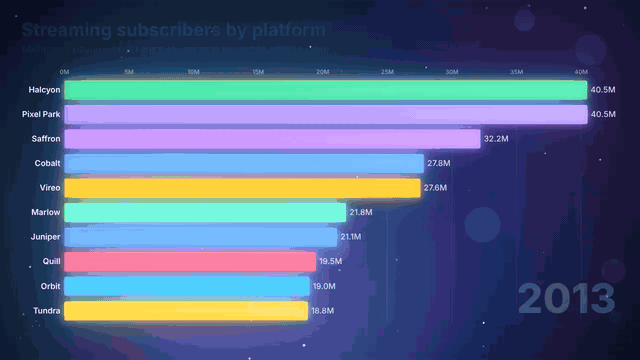
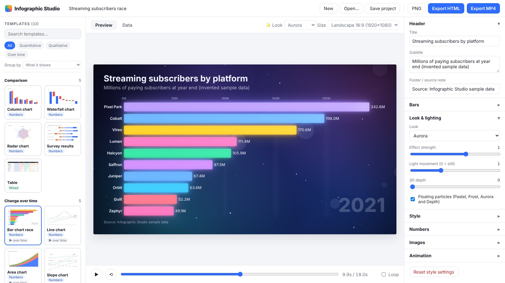
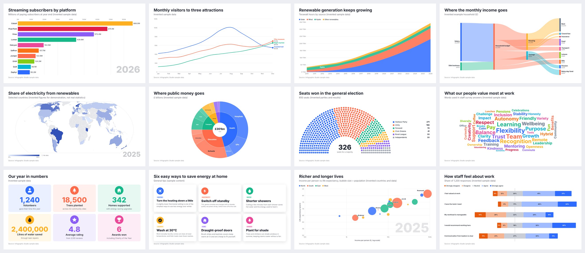
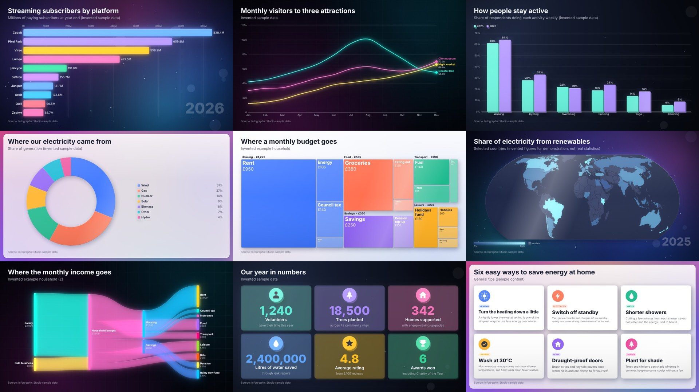
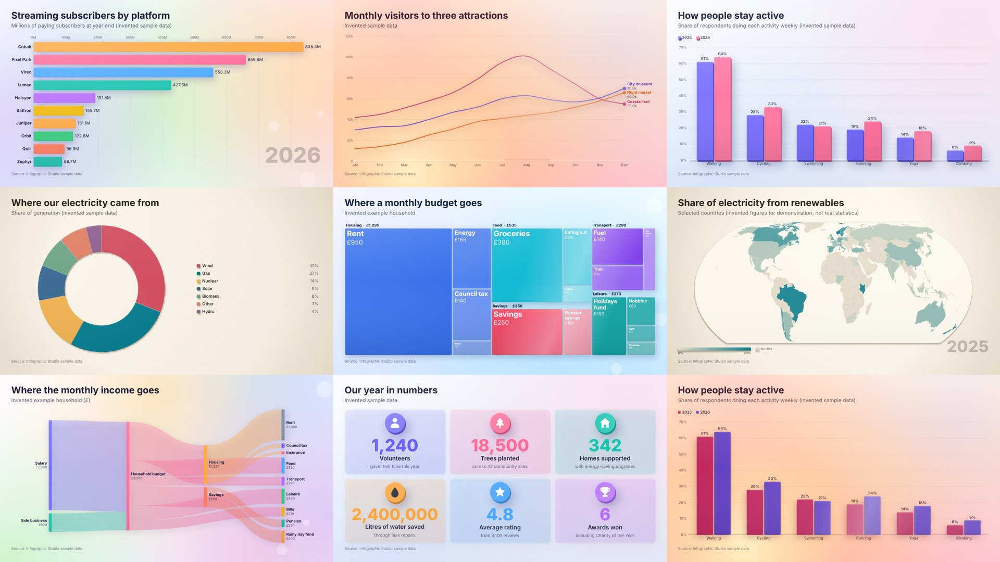
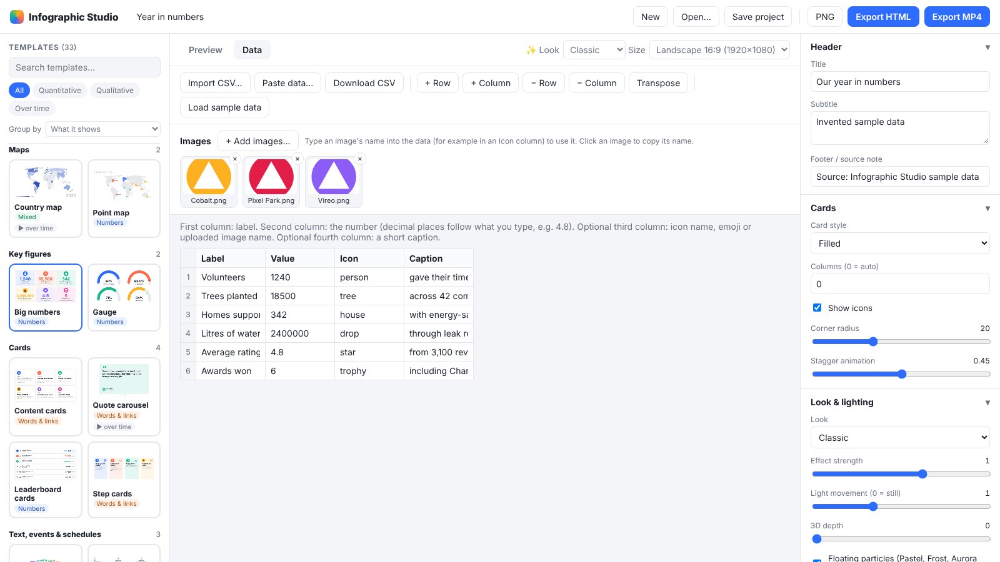
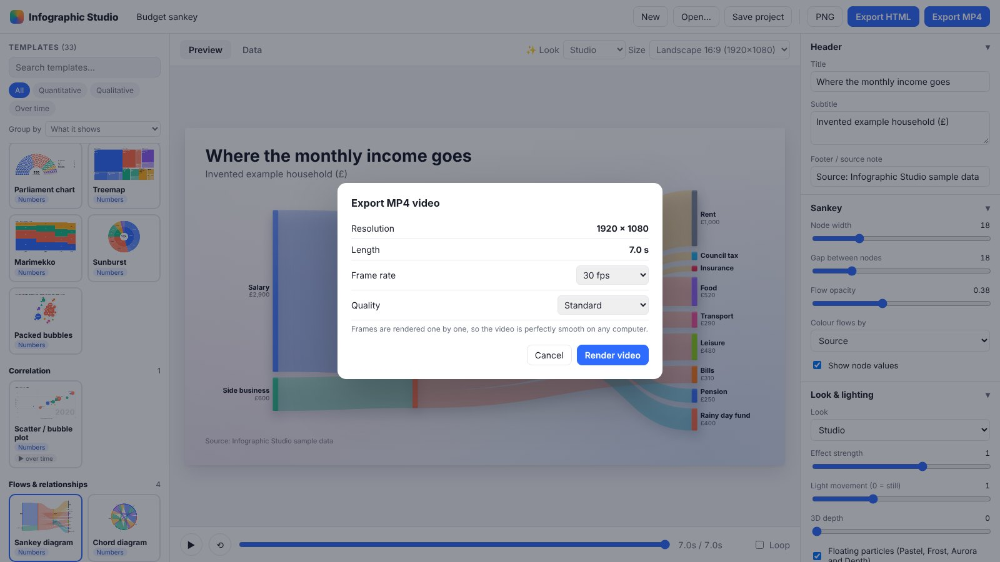

# Infographic Studio

Make animated charts and infographics in your browser, then export them as a standalone **HTML** page, an **MP4** video or a **PNG** image.

Paste or import your data, pick one of 33 templates, style it, and press play. Everything runs on your own computer: nothing is uploaded, and you don't need an account or an internet connection.



*A bar chart race in the Aurora look, made with the sample data and exported as video.*

## Screenshots

**1. The editor.** Choose a template on the left, preview and scrub through the animation in the middle, and change the settings on the right. The **✨ Look** menu switches between Classic, seven light looks and three dark ones.



**2. Thirty-three templates.** Charts, maps, flows, hierarchies, key figures, cards and timelines. Here are 12 of them with their sample data.



**3. Looks and lighting.** Switch any chart to a look with an animated backdrop, a moving light, shadows, glow or 3D depth.





**4. Your data and images.** Edit data like a spreadsheet, paste from Excel or Google Sheets, import a CSV, and add your own images to use as icons, photos or logos.



**5. Export.** Videos are rendered frame by frame, so they're perfectly smooth whatever your computer's speed.



## Quick start

1. Download the app. Either:
   - Select the green **Code** button, then **Download ZIP**, and unzip it; or
   - Clone the repository with Git.
2. Double-click `index.html` to open it in Chrome or Edge (recommended), or a recent Firefox or Safari.
3. Pick a template, then open the **Data** tab and replace the sample data with your own.
4. Select **Export HTML**, **Export MP4** or **PNG**.

You don't need to install anything, run a server or know Git.

If your browser won't open local files, serve the folder from a terminal instead:

```bash
cd infographic-studio
python3 -m http.server 8000      # then open http://localhost:8000
```

## Using the app

1. **Choose a template.** Use the search box, the **Quantitative / Qualitative / Over time** filters, and **Group by** (what it shows, type of data, or A–Z) to find one.
2. **Add your data** in the **Data** tab. The hint above the grid tells you which columns the template expects, and **Load sample data** shows an example. You can:
   - type into the cells
   - paste a block from a spreadsheet
   - **Import CSV…** or **Paste data…**
   - drop a CSV file onto the window
3. **Style it** in the settings panel. Every template has the same title, subtitle, source note, colour palette, fonts, number format, logo, background image and animation timing settings. Each one also has its own options.
4. **Pick a size**: 16:9, square, 4:5, 9:16 for stories, 720p, 4K or a custom size.
5. **Export.**
   - **HTML**: one self-contained file. It plays when someone scrolls to it, has play and timeline controls on hover, and works offline or embedded in an `<iframe>`.
   - **MP4**: H.264 video at 24, 25, 30 or 60 fps.
   - **PNG**: a still of the current frame.
6. **Save project** downloads a `.infographic.json` file that you can **Open…** later. Your current work is also autosaved in the browser.

## Templates

| What it shows | Template | Data layout |
|---|---|---|
| **Comparison** | Column chart | Category, then one column per series. Options: vertical or horizontal, grouped or stacked, sorting. |
| | Waterfall chart | Step, change. Type `total` in the change column to add a subtotal. |
| | Radar chart | Measure, then one column per series. |
| | Survey results | Question, then answer columns from most negative to most positive (diverging Likert bars). |
| | Table | Any table. Number columns get inline bars or a heatmap. |
| **Change over time** | Bar chart race | Name, then one column per period. |
| | Line chart | X, then one column per series. Its *rank mode* turns it into a line chart race or bump chart. |
| | Area chart | X, then one column per series. Types: stacked, 100%, overlapping or streamgraph. |
| | Slope chart | Name, before value, after value. |
| | Calendar heatmap | Date, value. |
| **Part of a whole** | Donut / pie | Name, value. |
| | Treemap | Item, value, optional group. |
| | Sunburst | One column per hierarchy level, then a value. |
| | Packed bubbles | Name, value, optional group (circle packing). |
| | Marimekko | Category, then one column per segment. |
| | Icon chart | Category, value, optional icon. Grid or rows layout. |
| | Parliament chart | Party, seats, optional colour. |
| **Correlation** | Scatter / bubble plot | Name, period, X, Y, size, group. Bubbles move through the periods. |
| **Flows & relationships** | Sankey diagram | Source, target, value. |
| | Chord diagram | Source, target, value. |
| | Arc diagram | From, to, optional value. |
| | Network graph | From, to, optional value. Clusters are coloured automatically. |
| **Maps** | Country map | Country, then a value or category. Add more columns to animate through periods. |
| | Point map | Name, latitude, longitude, value, group. |
| **Key figures** | Big numbers | Label, number, optional icon, optional caption. |
| | Gauge | Label, value, optional min, max and target. |
| **Cards** | Content cards | Title, text, optional tag, icon and colour. Five card styles, with an icon circle, colour band or big emoji at the top. |
| | Quote carousel | Quote or fact, name, role, icon. Shows one card at a time with slide, fade or zoom transitions. |
| | Leaderboard cards | Name, value, change (e.g. +12%), icon, caption. Shows rank badges, values that count up and ▲▼ change markers. |
| | Step cards | Step title, description, icon. Numbered steps joined by arrows, running across or down. |
| **Text, events & schedules** | Word cloud | Word, weight. Or paste free text and the words are counted for you. |
| | Timeline | Date, title, optional description, optional icon. |
| | Gantt chart | Task, start date, end date, optional group. |


Each template is tagged **Numbers** (quantitative), **Words & links** (qualitative) or **Mixed**. Templates that play through time periods are marked **▶ over time**.

Similar chart styles are combined into one template with options rather than repeated:

- Grouped, stacked and horizontal bars are all the Column chart; stacked, 100%, overlapping and streamgraph areas are all the Area chart; pie and donut are one template.
- A line chart race (or bump chart) is the Line chart's *rank mode*.
- Number tickers and countdown-style figures are covered by Big numbers.
- Circle packing is the grouped form of Packed bubbles.

Interactive widgets such as quizzes, calculators and photo sliders aren't included, because they can't be turned into a video.

## Looks and lighting

The **✨ Look** menu above the preview restyles any template. *Classic* is the flat original; the other ten add effects that keep moving through the whole video.

| | Look | What you get |
|---|---|---|
| **Light** | **Studio** | A clean off-white backdrop with a spotlight that drifts across the chart. Shapes cast soft shadows that shift as the light moves, and catch a highlight on the edges facing it. |
| | **Glass** | A vivid moving gradient with the chart on a frosted-glass panel. |
| | **Pastel** | Soft pastel colours drifting behind the chart, with gentle floating bubbles. |
| | **Sunrise** | A warm peach-to-pink sky with a glowing sun that slowly rises. |
| | **Paper** | Cream dotted paper with crisp, short shadows, like cut-out card. |
| | **Frost** | Cool icy blues with drifting snow-like particles and a bright shine. |
| | **Clay** | Soft, rounded 3D blocks on a pale backdrop with big gentle shadows. |
| **Dark** | **Aurora** | Slowly drifting colour, floating particles, and shapes that glow. |
| | **Neon** | Near-black with a pulsing grid and strong neon glow. |
| | **Depth** | Shapes are extruded into 3D blocks under a spotlight. The sides swing as the light moves. |

Each look sets its own background, text colour and palette, which you can then change. Under **Look & lighting** in the settings you can adjust the effect strength, how fast the light moves (0 keeps it still), the 3D depth (which works in any look) and the floating particles.

Labels are drawn on a separate layer above the effects, so text stays sharp. Looks appear in the preview and in HTML, MP4 and PNG exports. In exported HTML the lighting keeps moving after the chart has finished animating.

## Icons and images

**Icons.** Wherever a template has an icon column, you can type a built-in icon name, an emoji, or the name of one of your images. The built-in icons are `person, heart, star, house, drop, leaf, bolt, car, tree, trophy, laptop, phone, sun, pound, globe, book, chat, check, circle, square`, and common synonyms such as `people`, `home`, `water`, `energy`, `money` and `award` also work. Any emoji works too: 🚲 🍎 🐟 📦.

**Images.** In the **Data** tab, select **+ Add images…** or drag image files (JPG, PNG, SVG, GIF, WebP) onto the window, then type an image's file name into your data. You can type `garden.jpg` or just `garden`. Clicking an image in the strip copies its name.

| Where | How images are used |
|---|---|
| Any **Icon** column (icon chart, big numbers, timeline, step cards, table cells and so on) | An image name works anywhere an icon name or emoji does. |
| **Content cards** | The image becomes a photo across the top of the card. |
| **Quote carousel** | A large photo beside the quote, or a small round avatar. |
| **Leaderboard cards** | A round avatar or logo beside the name. |
| **Bar chart race** | Name an image after a bar (e.g. `Cobalt.png`) and it appears on that bar automatically. |
| **Every template** (settings → *Images*) | A **logo** in any corner, and a faded **background image**. |


Large photos are scaled down to 1,400 px when you add them. Images are saved inside the project file. An exported HTML file includes only the images the chart uses, so it still works offline.

## Tips

- **Custom colours:** in *Custom colours*, give an item its own colour with one line per item, such as `Cobalt: #ff9900`.
- **Line chart race:** in the line chart, *Show rank instead of value* turns it into a line chart race or bump chart.
- **Word cloud:** leave the weight column empty and paste free text, such as survey answers, into the first column. The words are counted for you, and common words like "the" and "and" are ignored.
- **Country map:** it understands common names and abbreviations (UK, USA, DRC, Türkiye…). Names it can't match are counted in a small note on the chart. Add more number columns to animate through years.
- **Dates:** templates that take dates accept `YYYY-MM-DD`, `DD/MM/YYYY` or just a year.
- **Spacebar** plays and pauses the preview.

## Known limitations

- MP4 export needs a browser with WebCodecs: current Chrome, Edge, Firefox and Safari. Older browsers fall back to recording in real time, which may save a WebM file instead.
- Images must be uploaded into the project. Pictures linked from other websites can't be used, because browsers don't allow them to be recorded into a video.
- The country map shows whole countries only. There are no UK regions or local authority boundaries yet.
- Projects with many large images can be too big for the browser's autosave. Use **Save project** to keep them.
- Looks other than Classic take more work to draw. Previews may play less smoothly on slower computers, and video export takes longer, but exported videos are always smooth.
- Exported HTML charts animate, but they don't have hover pop-ups or filters.
- All the sample data is invented for demonstration.

## How it works

```
index.html          Editor UI
css/app.css         Editor styles
js/runtime.js       Chart engine: all templates, drawing, playback (no dependencies)
js/exporters.js     HTML / MP4 / PNG export
js/app.js           Editor logic (settings panel, data grid, files)
js/samples.js       Sample projects (invented data)
js/csv.js           CSV parser
vendor/mp4-muxer.js MP4 container writer (MIT licence)
vendor/world.js     World country outlines for the map templates
```

- **One renderer for everything.** `Infographic.draw(ctx, width, height, project, timeInSeconds)` paints a single frame onto a canvas, and its output depends only on the time you pass in. The preview, the HTML export and the MP4 export all use this same call, so what you see in the editor matches the exports.
- **HTML export** copies the source of `InfographicRuntime` into the file along with your project JSON. That's why the exported file needs nothing else.
- **MP4 export** draws every frame to an offscreen canvas, encodes it with the browser's WebCodecs `VideoEncoder` (H.264) and packages the result with `mp4-muxer`. Browsers without WebCodecs fall back to real-time recording with `MediaRecorder`, which may produce WebM.

## Adding a template

Add an entry to `TEMPLATES` in `js/runtime.js`:

```js
TEMPLATES.myChart = {
  name: 'My chart',
  description: 'One-line description',
  dataHint: 'How the data should be laid out',
  settings: [ { group: 'My chart', key: 'thing', label: 'Thing', type: 'checkbox', def: true } ],
  draw: function (C, R) {
    // C.ctx canvas, C.S settings, C.T data rows, C.u size unit,
    // C.pLinear / C.pEased progress 0→1. R = {x,y,w,h} plot area.
  }
};
```

Then add a matching sample in `js/samples.js`, and give the template a line in `META` (near the end of `runtime.js`) so the picker knows its category, its data type and whether it animates over time. The settings panel, thumbnail and every exporter pick up the new template automatically.

## Created with Claude

This tool was designed and written by [Claude](https://claude.ai), an AI assistant made by [Anthropic](https://www.anthropic.com), through a conversation with the repository owner. The owner directed the project and tested the result.

## Status

This project is shared as-is. It isn't actively maintained, and contributions (issues and pull requests) aren't being accepted. You're free to copy it and adapt it for your own use. It has no build step and no dependencies to install.

## Licence

Released under the [MIT License](LICENSE).

It includes:
- [mp4-muxer](https://github.com/Vanilagy/mp4-muxer), MIT licence (`vendor/mp4-muxer.LICENSE`)
- world map outlines from [Natural Earth](https://www.naturalearthdata.com) (public domain), via [world-atlas](https://github.com/topojson/world-atlas), ISC licence (`vendor/world-atlas.LICENSE`)
